<picture>
  <source media="(prefers-color-scheme: dark)" srcset="images/banner-dark.svg">
  
</picture>

  
  
  
  

### Right now

Research Assistant at Northeastern's Roux Institute, in a research partnership with **IDEXX**: teaching a vision-language model to read veterinary microscopy images cell by cell.

- Fine-tuned **MedGemma 1.5 4B** with LoRA on both the language model and the SigLIP image encoder, reaching **micro-F1 0.87** on held-out images
- Built the training set on **Databricks**: 300k+ microscope images, relabeled with Cellpose-SAM into **1.1M** cells, each counted exactly once
- Implemented **GRPO** from scratch in PyTorch, and made inference **~4× faster** (1.6 → 6.5 images/s)

### Publications

<table>
<tr>
<td width="50%" valign="top">

**A Hybrid ResNet-ViT Architecture for Skin Cancer Classification** 
IEEE AIC 2025 · first author

A frozen ResNet50 fused with an 8-head Vision Transformer block. **96.3%** accuracy across seven lesion types on HAM10000.

[Paper](https://doi.org/10.1109/AIC66080.2025.11212073) · [Code](https://github.com/ShubhamGajjar/SkinCancer-Hybrid-ResNet-ViT)

</td>
<td width="50%" valign="top">

**VGG16-MCA UNet: Whole-Tumor Segmentation in 2D FLAIR MRI** 
arXiv 2026 · first author

Decoder-side channel attention, chosen through a ten-variant study. Pooled Dice of **95.10%** on BraTS 2020.

[arXiv](https://arxiv.org/abs/2609.23919) · [Code](https://github.com/ShubhamGajjar/vgg16-mca-unet)

</td>
</tr>
</table>

### Projects

<table>
<tr>
<td width="50%" valign="top">

**MorphoCLIP** 
Research capstone · 2026

Search Cell Painting screens by describing a perturbation in words. DINOv3 image features aligned to text, trained with multi-GPU DDP on HPC. Recall@10 of **37–41%** against ~10% chance.

</td>
<td width="50%" valign="top">

**ENCOM** 
Speech-to-speech · 2026

Skips the speech-to-text step: a Mamba audio encoder feeds SmolLM2-360M directly, with ONNX and CoreML export for on-device use.

</td>
</tr>
<tr>
<td width="50%" valign="top">

**[TrackMania RL](https://github.com/ShubhamGajjar/TrackMania-ReinforcementLearning)** 
Reinforcement learning · 2024

An IQN agent that drives from raw screen pixels. After ~30 hours of training its best lap, **54.06 s**, beat two of our four human drivers.

</td>
<td width="50%" valign="top">

**[GMSM-USA](https://www.gmsmamerica.org)** 
Full-stack · 2026 – present

A community platform I built and maintain on my own: **300+ members** across 45 states, with access control enforced by Postgres row-level security.

</td>
</tr>
</table>

Also: [Dempsey Center Survey Analysis](https://github.com/ShubhamGajjar/Dempsey-Center-Survey-Analysis) · [Windows 11 Customizer](https://github.com/ShubhamGajjar/Windows-11-Customizer) · [Book Recommendation Engine](https://github.com/ShubhamGajjar/Book-Recommendation-Engine)

### Toolkit

<picture>
  <source media="(prefers-color-scheme: dark)" srcset="https://skillicons.dev/icons?i=py%2Cpytorch%2Ctensorflow%2Csklearn%2Copencv%2Caws%2Cdocker%2Clinux%2Cnextjs%2Creact%2Cpostgres%2Csupabase%2Cgit&theme=dark&perline=13">
  
</picture>

Plus Hugging Face Transformers, PEFT, TRL, Databricks, Spark, MLflow, CUDA and Slurm.

<picture>
  <source media="(prefers-color-scheme: dark)" srcset="https://raw.githubusercontent.com/ShubhamGajjar/ShubhamGajjar/output/github-snake-dark.svg">
  
</picture>
